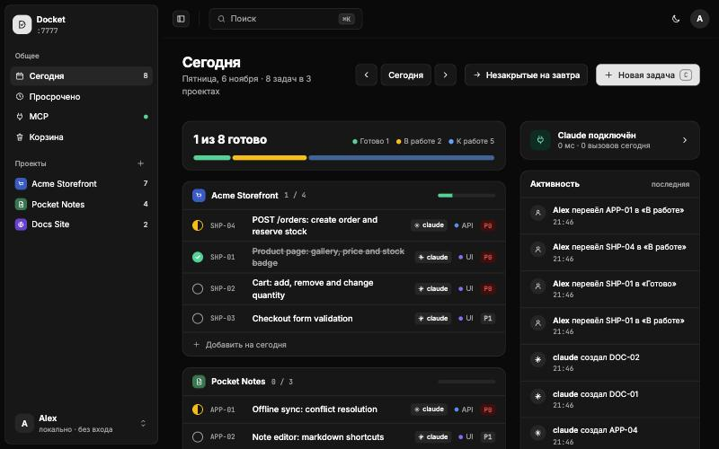
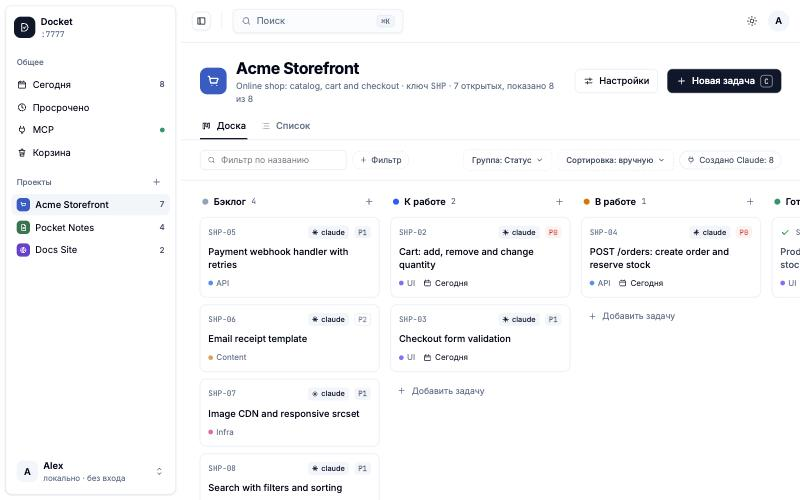
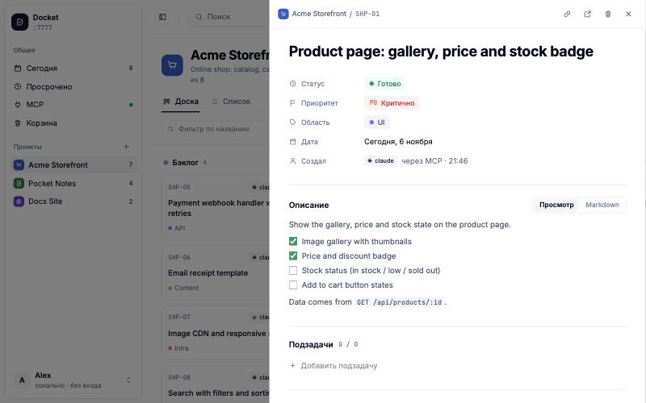
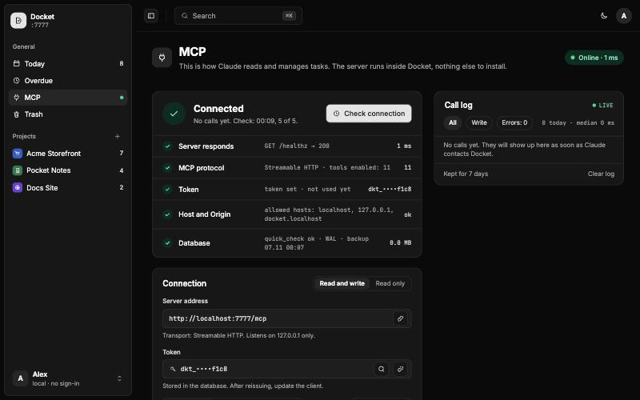

# Docket

[](https://github.com/Jykitro/Docket/actions/workflows/ci.yml)
[](https://github.com/Jykitro/Docket/releases)
[](LICENSE)

A personal task planner that runs locally in Docker: one container, one Go process, one SQLite database.
Claude manages tasks over [MCP](https://modelcontextprotocol.io); you review and edit them in the web UI.
Both channels go through the same service layer, so validation, change history and live updates behave identically.

No external services, and in the default local mode no users and no login. The UI never talks to an outside host
(fonts are bundled).

<p align="center">
  
</p>

> The interface is in Russian. The screenshots show demo data, not real projects.

## Contents

- [Features](#features)
- [Quick start](#quick-start)
- [Configuration](#configuration)
- [Self-host](#self-host)
- [Using the UI](#using-the-ui)
- [Connecting Claude (MCP)](#connecting-claude-mcp)
- [Development](#development)
- [REST API](#rest-api)
- [Troubleshooting](#troubleshooting)
- [Contributing and license](#contributing-and-license)

## Features

- **Today view.** Day plan, overdue tasks, progress, recent activity and MCP status in one place.
- **Kanban board and list.** Per-project statuses, drag and drop, filters, grouping, sorting and saved views.
- **Rich tasks.** Markdown description with clickable checkboxes, subtasks, notes and a full change history.
- **Claude as a teammate.** 16 MCP tools, a read-only mode, per-tool switches and an audit log of every call.
- **Live updates.** Changes made over MCP show up in the browser immediately (server-sent events).
- **Safe by default.** Bound to `127.0.0.1`, `Host` and `Origin` checks, bearer token for `/mcp`.
- **Easy to keep.** A single SQLite file, automatic daily backups, a trash bin and a full JSON export.

<table>
  <tr>
    <td width="50%"><br><sub><b>Board.</b> Columns per status, filters, grouping and saved views.</sub></td>
    <td width="50%"><br><sub><b>Task panel.</b> Properties, markdown with checkboxes, subtasks, notes and history.</sub></td>
  </tr>
</table>

## Quick start

Requirements: [Docker](https://docs.docker.com/get-docker/). [`make`](https://www.gnu.org/software/make/) is optional but convenient.

Prebuilt image (published with every release, `linux/amd64` and `linux/arm64`):

```bash
docker run -d --name docket -p 127.0.0.1:7777:7777 -v "$PWD/data:/data" --restart unless-stopped \
  ghcr.io/jykitro/docket:latest
```

Or download a binary for Linux, macOS or Windows from the [releases page](https://github.com/Jykitro/Docket/releases)
and run it. Outside Docker set `DOCKET_ADDR=127.0.0.1:7777` (the default `:7777` listens on every interface) and point
`DOCKET_DB` and `DOCKET_BACKUP_DIR` at local paths, since they default to `/data/...` (see
[Configuration](#configuration)). To build from source:

```bash
make rebuild   # creates .env from .env.example, builds the docket:local image and (re)starts the container
```

The same command rebuilds and restarts the container after you change the code; your data in `./data` is kept.
Other targets: `make logs`, `make stop`, `make help`.

Without `make`, run the equivalent commands:

```bash
cp .env.example .env
docker build -t docket:local .
docker run -d --name docket --env-file .env -p 127.0.0.1:7777:7777 \
  -v "$PWD/data:/data" --restart unless-stopped docket:local
```

Open <http://docket.localhost:7777> (Chrome resolves `*.localhost` on its own; other browsers can use
<http://localhost:7777>). Health check: `curl localhost:7777/healthz`.

On the first run with an empty database Docket asks for your name and a first project, then drops you into the app.

### What to know

- The port is published on `127.0.0.1` only.
- Requests with a foreign `Host` get `403`, and write requests to `/api` with a foreign `Origin` also get `403`
  (protection against DNS rebinding and CSRF).
- Data lives in `./data/docket.db`. A backup (`VACUUM INTO`) is written at startup and once a day to `./data/backups`;
  the last 14 are kept.
- Seed data (optional): if `DOCKET_SEED` points to a JSON file and the database has no projects, it is imported at
  startup (`{"projects": […], "tasks": […]}`: projects by `slug`, tasks by `external_id`, author `claude`). Running it
  again does not create duplicates. No seed file ships with Docket.

## Configuration

Settings are read from `.env` (see `.env.example`):

| Variable | Default | Description |
|---|---|---|
| `DOCKET_MODE` | `local` | `local`: one user, no login. `selfhost`: several users behind a login, see [Self-host](#self-host) |
| `DOCKET_ADDR` | `:7777` | Server address inside the container |
| `DOCKET_DB` | `/data/docket.db` | Database file |
| `DOCKET_BACKUP_DIR` | `/data/backups` | Where backups are written |
| `DOCKET_MCP_TOKEN` | empty | Optional. If set, it takes precedence over the token stored in the database and rotating it in the UI is disabled |
| `DOCKET_ALLOWED_HOSTS` | `localhost,127.0.0.1,docket.localhost` | Allowed `Host` and `Origin` values |
| `DOCKET_SEED` | empty | Optional initial data file |
| `TZ` | `Asia/Ho_Chi_Minh` | Time zone used to decide what "today" is |

## Self-host

`DOCKET_MODE=selfhost` turns Docket into a server for several people: everyone logs in with a username and password,
and every profile has its own database, its own MCP token and its own backups. `local` mode (the default) works as
before.

1. In `.env`, set `DOCKET_MODE=selfhost` and put your real domain in `DOCKET_ALLOWED_HOSTS` (for example
   `docket.example.com`).
2. Put an HTTPS reverse proxy in front of the container and do not publish port `7777` without it. The session cookie
   is marked `Secure` only over HTTPS (or with `X-Forwarded-Proto: https`), so logging in without a proxy is not safe.
3. On first start the log contains a one-time setup code: `docker logs docket` (the line
   `first run: create the admin with this setup code`). Open the site and create the administrator with that code.
   The code works until the first user exists and is never printed again after that. Until an administrator exists,
   every restart prints a new code and the previous one stops working.
4. The administrator invites everyone else from Settings: an invite link creates a profile.

Data: `auth.db` (users and sessions) and `users/<id>.db` (one database per profile) sit next to `DOCKET_DB`; profile
backups are written to `DOCKET_BACKUP_DIR/<id>`, and a profile created later gets its first backup within an hour.
Every profile has its own MCP token, shown on the **MCP** tab. Claude connects to the same `/mcp` address and the
profile is picked by the token. `DOCKET_SEED` and `DOCKET_MCP_TOKEN` are ignored in this mode (a warning is logged if
`DOCKET_MCP_TOKEN` is set).

Switching an existing install to `selfhost` does not import `DOCKET_DB` (`docket.db`): the file stays untouched and
selfhost profiles start empty. Switching back to `local` brings the old data back.

Never delete or recreate `auth.db` while `users/` holds files: user ids start again at 1, so the new profiles would
open the old profiles' databases and MCP tokens. To start from scratch, first move `users/` and the per-profile backup
directories in `DOCKET_BACKUP_DIR` aside.

Limits:

- Behind a reverse proxy, login rate limiting is counted per proxy address, so one client's failed attempts can lock
  a username for everyone for 10 minutes.
- There is no password reset by email: the administrator deletes the profile and issues a new invite. Deleting a
  profile removes `users/<id>.db`, but its backups in `DOCKET_BACKUP_DIR/<id>` stay and must be removed by hand.

## Using the UI

| Screen | Address | What it does |
|---|---|---|
| Today | `/` | Day plan, overdue tasks, progress, activity and MCP status; the status circle cycles todo → doing → done |
| Project board | `/p/:slug` | Columns per project status, drag and drop, filters, grouping, sorting, a list tab and saved views |
| Task panel | `?task=TRK-07`, `/t/TRK-07` | Properties, markdown description with clickable checkboxes, subtasks, notes and history |
| Project settings | `/p/:slug/settings` | Icon, colour, key, statuses, labels, custom fields, views, export, archive and delete |
| MCP | `/mcp` | Status and self-check, address and token, access mode, tool switches and the call log |
| Trash | `/trash` | Restore tasks and projects, or empty the trash |

**Keyboard:** `C` creates a task, `⌘K` / `Ctrl+K` opens search, `Esc` closes the panel, search and dialogs.

**Layout and theme:** the top bar collapses the sidebar to an icon rail (a drawer on narrow screens) and switches the
theme between light, dark and system.

**Task IDs** look like `TRK-07`: the project key plus a number. Numbers are never reused. You can change a project key in
its settings and every ID is renumbered, but old links that use the previous key stop working.

## Connecting Claude (MCP)

On the first start Docket creates a `dkt_…` token, prints it to the log once and stores it in the database. After that it
is shown (masked, with a "Show" button) on the **MCP** tab, where you can also rotate it and copy a ready-made config.

<p align="center">
  
</p>

**Claude Code:**

```bash
claude mcp add --transport http docket http://localhost:7777/mcp --header "Authorization: Bearer <TOKEN>"
```

**Claude Desktop** (`claude_desktop_config.json`):

```json
{
  "mcpServers": {
    "docket": {
      "command": "npx",
      "args": ["-y", "mcp-remote", "http://localhost:7777/mcp",
               "--header", "Authorization:${AUTH}", "--allow-http"],
      "env": { "AUTH": "Bearer <TOKEN>" }
    }
  }
}
```

**Codex** (the token is read from an environment variable, so it stays out of `config.toml`):

```bash
export DOCKET_MCP_TOKEN=<TOKEN>
codex mcp add docket --url http://localhost:7777/mcp --bearer-token-env-var DOCKET_MCP_TOKEN
```

### Agent skill: Docket as a personal planner

Three skills in [`skills/`](skills), one `SKILL.md` each:

| Skill | What it covers |
|---|---|
| [`docket`](skills/docket/SKILL.md) | The workflow: find or create a task and put its plan in the description as a checklist, tick steps and add notes as it goes, file every problem it spots as a backlog task with the area `issue`, reconcile before each final message so nothing is left stale. About 2 KB on purpose |
| [`docket-reference`](skills/docket-reference/SKILL.md) | The answers an agent needs: data model, every tool and its quirks, error codes, conventions for plans, notes and issues, a FAQ |
| [`docket-setup`](skills/docket-setup/SKILL.md) | Connecting Claude Code, Claude Desktop and Codex, installing the skills, the hooks, troubleshooting |

- Docket sends the body of `docket` to every client as the MCP server instructions, so a connected agent has the workflow already. A test keeps it under the 2048 bytes Claude Code accepts, which is why the detail lives in the other two skills.
- To have the skills trigger from the first message, install them. The **MCP** tab has an **Install in one command** button: it
  copies one line to paste into a terminal (macOS, Linux). The script writes all three skills for Claude Code (`~/.claude/skills`)
  and Codex (`~/.agents/skills`) and registers the MCP server in whichever of the two it finds. It is served at
  `/api/mcp/install.sh` and reads the address and token from `DOCKET_URL` and `DOCKET_TOKEN`, which the button fills in:

  ```bash
  curl -fsSL http://localhost:7777/api/mcp/install.sh | DOCKET_URL=http://localhost:7777/mcp DOCKET_TOKEN=<token> sh
  ```

  By hand, the same tab has Copy and Download buttons, and the server serves each skill at `/api/mcp/skill/<name>`.
  Claude Code reads `~/.claude/skills/<name>/SKILL.md`, Codex `~/.agents/skills/<name>/SKILL.md`:

  ```bash
  for s in docket docket-reference docket-setup; do
    mkdir -p ~/.claude/skills/$s    # Codex: ~/.agents/skills/$s
    curl -fsS http://localhost:7777/api/mcp/skill/$s -o ~/.claude/skills/$s/SKILL.md
  done
  ```

  In selfhost mode the API needs a login: use the Download buttons instead.
- Optional strict mode, the same JSON for Claude Code and Codex (the snippet is on the **MCP** tab): a `SessionStart`
  hook reminds the agent to find or create the task, and a `Stop` hook makes it run the reconcile step before it
  finishes. It blocks only the first stop of a turn, so it cannot loop. Claude Code: the project's
  `.claude/settings.json`. Codex: `~/.codex/hooks.json` (hooks are on by default). Codex's file is global, so in a repo
  without Docket the agent answers "not tracked" and finishes.

### Tools

There are 16 tools. Tasks are referred to by ID (`TRK-07`) in responses, `project` accepts a key, a slug or an id, and a
status is given by its key.

| Read | Write |
|---|---|
| `list_projects`, `get_board`, `get_today`, `get_task`, `search`, `list_pages`, `read_page` | `create_project`, `create_tasks` (up to 100 at a time, epics with subtasks via `ref`/`parent_ref`, idempotent by `external_id`), `update_task`, `move_tasks`, `add_note`, `write_page`, `append_to_page`, `carry_over`, `delete_tasks` |

- `delete_tasks` is **off** by default. It only moves tasks to the trash; the owner empties the trash in the UI.
- Wiki: `write_page` creates a page or replaces its whole body (pass the `updated_at` from `read_page` as `expected_updated_at`;
  a newer edit by the owner returns `conflict`), `append_to_page` adds to the end. There is no delete tool: the owner deletes
  pages in the UI.
- Read-only mode keeps only the read tools; writes return `forbidden`. A disabled tool is hidden from `tools/list`, and
  calling it by name returns `tool_disabled`.
- Every call is logged (tool, short arguments, duration, result). The log is kept for 7 days.
- An unknown area on a task creates a project label automatically. `create_tasks` and `update_task` accept values for custom
  fields by name (`custom`).

## Development

Requirements: Go (see `go.mod`), [Bun](https://bun.sh) and `make`.

```bash
make install   # frontend dependencies (bun install --frozen-lockfile)
make check     # typecheck + Knip (unused code and dependencies) + Go tests
```

Go tests open a port on localhost. Run `make help` for every target:

| Target | What it does |
|---|---|
| `make web` | Frontend build: `tsc --noEmit` and `vite build` into `internal/web/dist` |
| `make build` | Builds `bin/docket` with the UI embedded |
| `make test` | Backend tests (`go test ./...`) |
| `make typecheck`, `make knip` | Frontend checks |
| `make dev-api` | Backend on `:7777` with a separate `./data/dev.db` |
| `make dev-web` | Vite with hot reload (proxies `/api` to `:7777`) |
| `make image`, `make rebuild`, `make stop`, `make logs` | Docker image and container |
| `make clean` | Removes `bin/` and the built frontend |

For frontend work with hot reload, run `make dev-api` in one terminal and `make dev-web` in another.

Working on Docket with an assistant: [`AGENTS.md`](AGENTS.md) (read by Codex and most agents) and [`CLAUDE.md`](CLAUDE.md)
(Claude Code, imports `AGENTS.md`) describe the commands, layout, conventions and gotchas.

### Project layout

```
cmd/docket          config, wiring, graceful shutdown, housekeeping (daily backup and call-log cleanup)
internal/store      SQLite, migrations (migrations/*.sql), all SQL
internal/service    domain rules, validation, activity, events, MCP settings
internal/httpapi    REST, SSE /api/events, host/origin guard, bearer auth for /mcp, MCP self-check
internal/mcpserver  MCP tools → service, access policy and call log
internal/events     pub/sub for SSE
internal/web        embedded SPA (dist)
web/                React + TypeScript + Vite + Tailwind CSS v4 (shadcn-admin look; tokens in web/src/styles.css)
```

Layering rule: `httpapi` and `mcpserver` call only `service`, and SQL lives only in `store`.

## REST API

All requests are performed on behalf of the human actor (stored as `denis`; the UI shows the profile name). Errors come as
`{"error": {"code", "message"}}` (`validation` 400, `not_found` 404, `status_in_use` 409, `conflict` 409, `forbidden` 403). A task in the
path can be given by code (`TRK-07`) or by id.

| Method and path | Purpose |
|---|---|
| `GET/POST /api/projects`, `PATCH/DELETE /api/projects/:id` | Projects; `DELETE` moves a project to the trash |
| `POST /api/projects/:id/archive`, `POST /api/projects/:id/restore`, `GET /api/projects/:id/export` | Archive, restore from the trash, JSON export |
| `GET/POST /api/projects/:id/statuses`, `PATCH/DELETE /api/statuses/:id`, `POST …/statuses/reorder` | Statuses; `DELETE ?move_to=<id>` moves the tasks |
| `GET/POST /api/projects/:id/labels`, `PATCH/DELETE /api/labels/:id` | Area labels |
| `GET/POST /api/projects/:id/fields`, `PATCH/DELETE /api/fields/:id` | Custom fields (`number`, `url`, `select`) |
| `GET/POST /api/views?project=`, `PATCH/DELETE /api/views/:id` | Saved views |
| `GET /api/today?date=` | Tasks for a date, overdue tasks and recent activity |
| `GET /api/tasks?project=&status=&planned_for=&area=&created_by=&q=&parent=&include_done=1` | Task list |
| `POST /api/tasks`, `GET/PATCH/DELETE /api/tasks/:id` | CRUD; `planned_for: ""` clears the date |
| `POST /api/tasks/:id/move` | `{status, before_id?, after_id?, project_id?}` (drag and drop) |
| `POST /api/tasks/:id/restore`, `POST /api/tasks/:id/notes`, `POST /api/tasks/carry-over` | Restore, add a note, move tasks from one date to another |
| `GET /api/tasks/:id/pages` | Wiki pages that mention the task (`[{id, title, project}]`) |
| `GET/POST /api/projects/:id/pages` | Wiki pages of a project (without bodies); create (`title`, `body_md?`, `parent_id?`) |
| `GET/PUT/DELETE /api/pages/:id` | A page with backlinks and links; update (`expected_updated_at` returns `conflict` 409 if the page changed); `DELETE` re-parents children |
| `GET /api/search?q=&scope=all\|tasks\|projects` | Tasks by title and description (with a snippet), and projects |
| `GET /api/trash`, `GET /api/trash/projects`, `DELETE /api/trash` | Trash and emptying it (physical delete) |
| `GET /api/mcp/status`, `POST /api/mcp/check`, `GET/PATCH /api/mcp/settings` | Status, self-check, mode and tool switches |
| `GET /api/mcp/token`, `POST /api/mcp/token/rotate`, `GET/DELETE /api/mcp/calls` | Token, rotation, call log |
| `GET/PUT /api/profile` | Display name (an empty name means first run) |
| `GET /api/events` | SSE: `{type, task_id?, project_id?, actor}` |
| `GET /api/export`, `GET /healthz` | Full dump, liveness check |

## Troubleshooting

- **`/mcp` returns 401.** You need the header `Authorization: Bearer <TOKEN>`; find the token on the MCP tab. The **MCP**
  page itself opens in a browser without a token: requests with `Accept: text/html` get the UI.
- **403 `forbidden_host`.** Add the host name to `DOCKET_ALLOWED_HOSTS` and restart the container.
- **The self-check is red.** Each row on the MCP tab explains what to do. Logs: `make logs` (or `docker logs docket`).
- **Start from scratch.** Stop the container and delete `./data/docket.db*`; backups are in `./data/backups`.

## Contributing and license

Issues and pull requests are welcome: see [CONTRIBUTING.md](CONTRIBUTING.md). Report vulnerabilities privately, as
described in [SECURITY.md](SECURITY.md). Docket is released under the [MIT License](LICENSE).
