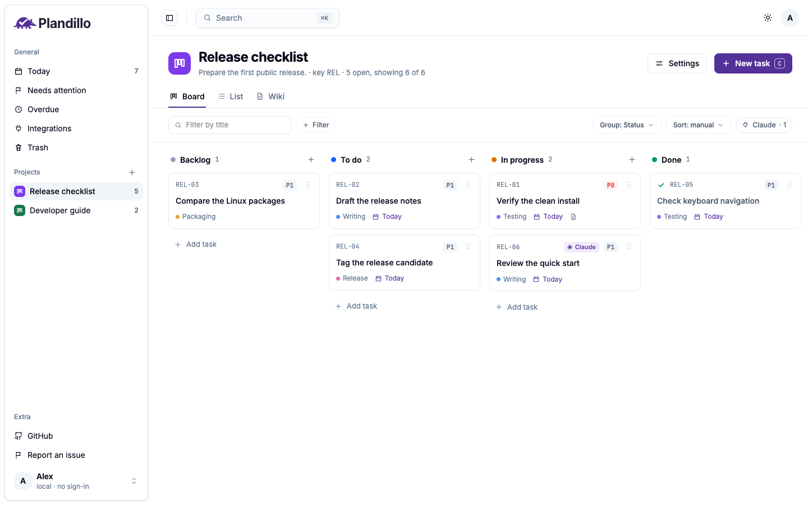

# Plandillo

<picture>
  <source media="(prefers-color-scheme: dark)" srcset="web/public/plandillo-inverse.svg">
  
</picture>

[](https://github.com/huntly-digital/plandillo/actions/workflows/ci.yml)
[](https://github.com/huntly-digital/plandillo/releases)
[](LICENSE)

Plandillo is an open-source task planner for you and your AI agent. Plan your day in the browser, then ask your agent to pick up a task, update its checklist or leave a note with what it verified. You see its changes live on the same board.

<p align="center">
  
</p>

## Quick start

With Docker installed, run these commands from the directory where you want to keep your tasks.

```sh
mkdir -p -m 700 data
docker run -d --name plandillo --user "$(id -u):$(id -g)" --pull=always \
  -p 127.0.0.1:7777:7777 -v "$PWD/data:/data" --restart unless-stopped \
  ghcr.io/huntly-digital/plandillo:main
```

Open <http://localhost:7777>, enter your name and create your first project. The default setup stores your board in SQLite under `./data`. The interface is available in English, Russian and Ukrainian.

## Connecting agents (MCP)

Open **Integrations** and copy the configuration for your agent. Codex and Claude Code need only the MCP URL. Sign in through the browser, choose a workspace and approve access. The client receives and refreshes its tokens automatically. A manual workspace token is available for scripts.

Install the three agent skills through skills.sh or the Plandillo plugin for Codex and Claude Code. [Installation commands](docs/agents.md#install-agent-skills)

Try asking *“Add a task to test the mobile menu tomorrow. Give it a checklist for touch and keyboard.”* Open the card to see the plan. After testing, ask your agent to record the results on that same card. [Agent setup and examples](docs/agents.md)

## Documentation

- [Using the planner](docs/planner.md) — plan your day, organize a project board, and keep notes and wiki pages alongside tasks.
- [Installation and hosting](docs/hosting.md) — Docker, native binaries, configuration, updates and troubleshooting.

### Self-host

For a shared installation, each account can own several private workspaces, each with its own MCP token. The [self-hosting guide](docs/hosting.md#self-host) covers invitations, HTTPS, SQLite or PostgreSQL, and backups. For the full planner on Vercel, see the [Vercel deployment guide](docs/vercel.md).

## Development

The planner and its public website share this repository. Use the [development guide](docs/development/README.md) to build the app, run tests and find your way around the code. The [REST API reference](docs/development/rest-api.md) lists the HTTP endpoints. The [landing page guide](landing/README.md) covers the site for `plandillo.dev`.

Plandillo is maintained by [Huntly Digital](https://github.com/huntly-digital) and released under the [MIT License](LICENSE). To take part, read the [contributing guide](CONTRIBUTING.md) and [Code of Conduct](CODE_OF_CONDUCT.md). To report a vulnerability, follow the [security policy](SECURITY.md).
