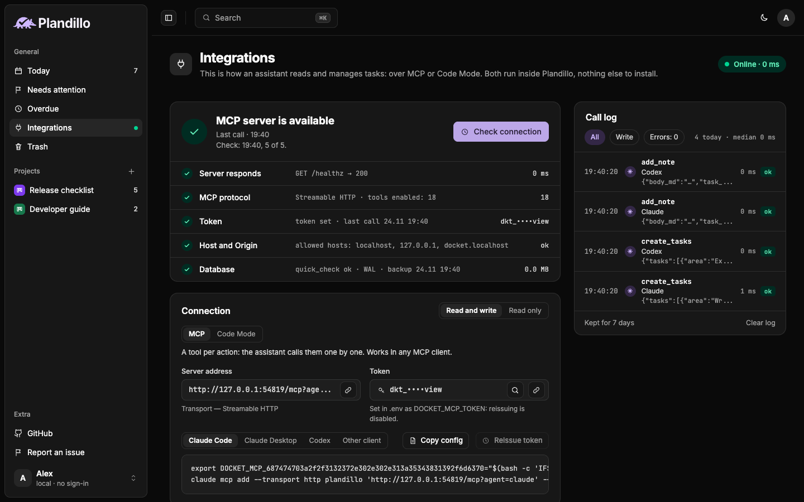

# Connecting your AI agent

Plandillo exposes your task board through the Model Context Protocol (MCP). Use an agent that can connect to a Streamable HTTP server and send a bearer token.

1. Open **Integrations** on your board and select **MCP**. Under **Other client**, optionally enter a name for your agent. Plandillo includes that name in the URL so you can recognize the agent’s notes and changes in the activity log.
2. Copy the server URL into your client’s MCP settings. For a local agent, the default endpoint is `http://localhost:7777/mcp`. For a hosted board, use its HTTPS address.
3. Copy the token from **Integrations** into the client’s secret settings and send it as `Authorization: Bearer <TOKEN>`. In a shared installation, use the token from your own profile.
4. Ask “What’s on my board today?” and check the call log in **Integrations** to confirm the connection.

The same tab has ready-made configurations for Claude Code, Claude Desktop and Codex. For a CLI preset, run the hidden-input command in the shell that starts the client. Repeat this step after rotating the token. When switching endpoints, copy the new endpoint’s configuration.

<p align="center">
  
</p>

## Try a shared task

Open a project in the web UI and connect a client using **Integrations**. Try these requests with your connected agent. For the last two, enable write access in **Integrations**.

- “Find the release checklist in my project. If it exists, show me the outstanding steps.” The agent searches and reads the task before making a change.
- “Add a task to review mobile navigation tomorrow, with a checklist for the menu and keyboard focus.” Open the new card to see its planned date and description.
- “Add the test results to that task. Mark it done if the checks passed.” The note and status appear in the same card, along with the name of the agent that changed it.

## Code Mode

[Start the isolated worker](hosting.md#code-mode-worker) to enable Code Mode.

At `/mcp/code`, the agent uses the same bearer token and
sees one tool, `code`, after [Cloudflare's Code Mode](https://developers.cloudflare.com/agents/tools/codemode/): it
writes JavaScript that calls the 19 tools as `await codemode.get_today({})`, loops and filters inside Plandillo, and gets
back only the result. That saves round trips and context on big jobs (triage, bulk moves, reports). The code runs in
an embedded sandbox with no network or files, for at most 30 seconds and 100 tool calls; access mode, tool switches
and the call log apply to every call it makes. Pick MCP or Code Mode on the **Integrations** tab: the address, the
configs and the install command follow. How it works inside: [Integration internals](integrations.md).

## Agent skill: Plandillo as a personal planner

Three skills in [`skills/`](../skills), one `SKILL.md` each:

| Skill | What it covers |
|---|---|
| [`plandillo`](../skills/plandillo/SKILL.md) | Find or create a task, record the plan as a checklist, add notes, call `report_issue` when a problem appears, and reconcile the board before the final message. |
| [`plandillo-reference`](../skills/plandillo-reference/SKILL.md) | The answers an agent needs: data model, every tool and its quirks, error codes, conventions for plans, notes and issues, a FAQ |
| [`plandillo-setup`](../skills/plandillo-setup/SKILL.md) | Connecting Claude Code, Claude Desktop and Codex, installing the skills, the hooks, troubleshooting |

- Plandillo sends the body of `plandillo` to every client as the MCP server instructions, so a connected agent has the workflow already. A test keeps it under the 2048 bytes Claude Code accepts, which is why the detail lives in the other two skills.
- To have the skills trigger from the first message, install them. The **Integrations** tab has an **Install in one command** button: it
  copies one line to paste into a terminal (macOS, Linux). The script writes all three skills for Claude Code (`~/.claude/skills`)
  and Codex (`~/.agents/skills`) and registers the MCP server in whichever of the two it finds. It is served at
  `/api/mcp/install.sh` and takes the address from `PLANDILLO_URL`. It prints the credential setup command after registration:

  ```bash
  curl -fsSL http://localhost:7777/api/mcp/install.sh | PLANDILLO_URL=http://localhost:7777/mcp sh
  ```

  By hand, the same tab has Copy and Download buttons, and the server serves each skill at `/api/mcp/skill/<name>`.
  Claude Code reads `~/.claude/skills/<name>/SKILL.md`, Codex `~/.agents/skills/<name>/SKILL.md`:

  ```bash
  for s in plandillo plandillo-reference plandillo-setup; do
    mkdir -p ~/.claude/skills/$s    # Codex: ~/.agents/skills/$s
    curl -fsS http://localhost:7777/api/mcp/skill/$s -o ~/.claude/skills/$s/SKILL.md
  done
  ```

  In selfhost mode the API needs a login: use the Download buttons instead.
- Optional strict mode, the same JSON for Claude Code and Codex (the snippet is on the **Integrations** tab): a `SessionStart`
  hook reminds the agent to find or create the task, and a `Stop` hook makes it run the reconcile step before it
  finishes. It blocks only the first stop of a turn, so it cannot loop. Claude Code: the project's
  `.claude/settings.json`. Codex: `~/.codex/hooks.json` (hooks are on by default). Codex's file is global, so in a repo
  without Plandillo the agent answers "not tracked" and finishes.

## Tools

There are 19 tools. Tasks are referred to by ID (`TRK-07`) in responses, `project` accepts a key, a slug or an id, and a
status is given by its key.

| Read | Write |
|---|---|
| `list_projects`, `get_board`, `get_today`, `get_task`, `search`, `list_pages`, `read_page`, `read_html` | `create_project`, `create_tasks` (up to 100 at a time, epics with subtasks via `ref`/`parent_ref`, idempotent by `external_id`), `update_task`, `move_tasks`, `add_note`, `report_issue`, `publish_html`, `write_page`, `append_to_page`, `carry_over`, `delete_tasks` |

- `delete_tasks` is **off** by default. It only moves tasks to the trash; the owner empties the trash in the UI.
- Wiki: `write_page` creates a page or replaces its whole body (pass the `updated_at` from `read_page` as `expected_updated_at`;
  a newer edit by the owner returns `conflict`), `append_to_page` adds to the end. There is no delete tool: the owner deletes
  pages in the UI.
- Read-only mode keeps only the read tools; writes return `forbidden`. A disabled tool is hidden from `tools/list`, and
  calling it by name returns `tool_disabled`.
- Every call is logged (tool, short arguments, duration, result). The log is kept for 7 days.
- An unknown area on a task creates a project label automatically. `create_tasks` and `update_task` accept values for custom
  fields by name (`custom`).
