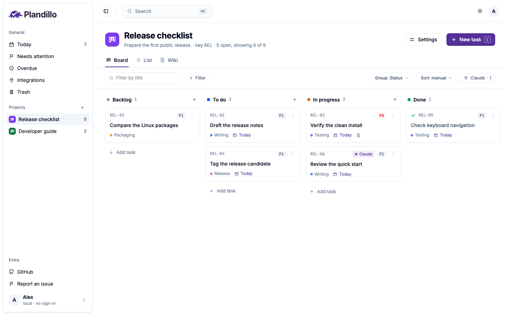
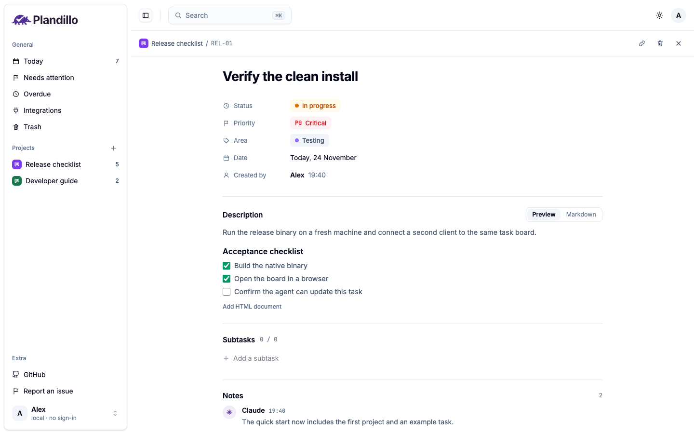

# Using the planner

| Screen | Address | What it does |
|---|---|---|
| Today | `/` | Day plan, overdue tasks, progress, activity and MCP status; the status circle cycles todo → doing → done |
| Needs attention | `/attention` | Review agent findings across projects, open the source task, take an issue, snooze it or close it with a reason |
| Project board | `/:slug` | Columns per project status, drag and drop, filters, grouping, sorting, a list tab and saved views |
| Project wiki | `/:slug/wiki`, `/:slug/wiki/:page` | Right-click a page or open its ⋯ menu to pin it or change its place among siblings. You can also drag pages and tick Markdown checklists while reading. |
| Task panel | `?task=TRK-07`, `/t/TRK-07` | Properties, markdown description with clickable checkboxes, subtasks, notes and history |
| Project settings | `/:slug/settings` | Icon, colour, key, statuses, labels, custom fields, views, export, archive and delete |
| Integrations | `/integrations` | MCP or Code Mode: status and self-check, address and token, access mode, tool switches and the call log |
| Trash | `/trash` | Restore tasks and projects, or empty the trash |

A project whose slug equals a reserved word (`settings`, `trash`, `api` and the other first segments of these addresses) keeps the `/p/:slug` form. Old `/p/:slug` links still open and switch to the short address. In a shared installation every address starts with `/w/:workspace`.

**Keyboard:** `C` creates a task, `⌘K` / `Ctrl+K` opens search, `Esc` closes the panel, search and dialogs.

**Layout and theme:** the top bar collapses the sidebar to an icon rail (a drawer on narrow screens) and switches the
theme between light, dark and system.

**Offline:** the installed app or an open tab starts without the server, because the service worker stores the whole interface. Pages you opened before (Today, boards, tasks, wiki pages, search results, trash and projects) stay on the device for up to 7 days and open offline, also after a reload. A notice in the bottom-left corner says "No connection to the server" or "No internet", with the time the data on screen was last confirmed. Changes are not possible offline: an edit is rolled back at once and the notice says it was not saved; nothing is sent later. When the connection returns, the notice says it is updating the data, then disappears. A reverse proxy answering 502, 503 or 504 counts as no connection. A page you have never opened shows "Not available offline". Sign-in, passkeys, sessions, two-factor settings, user administration, OAuth and integration/MCP screens, and published HTML documents are not stored on the device. Signing out, or the server ending your session, clears the stored data; another account on the same browser never sees it.

**Needs attention** brings open issues from every project together, including existing tasks with area `issue`. An agent
calls `report_issue` as soon as it notices a problem. Supply the project, a short title, the observation and, when known,
the source task. A matching open title in that project receives the observation. Supply `existing_issue` to target a
known duplicate under another title. Exact retries from the same agent and source add one observation. Blockers and
decisions appear first. Start work, snooze until a date in the server time zone, or close with a reason.

**Wiki page formats.** Choose Markdown or HTML before saving a new page. For an HTML page, paste source or
load a self-contained HTML file (up to 2 MiB). The page displays the interactive document directly.
In a Markdown wiki page or task description, use **Insert HTML** to insert an `html-preview` fenced block at the cursor.
An ordinary `html` code fence displays source code. Both standalone pages and embedded blocks use the isolated HTML viewer.

A workspace retains up to 64 MiB and 4,096 HTML revisions. Existing history remains readable when the quota is reached.

**Interactive HTML documents** can be attached to tasks and wiki pages. Paste source or choose an HTML file and
publish it. The interactive content appears inline with the Markdown. Expand the document title below the preview
to choose a version, edit the source or delete the document. Each publication records the author and
date. The JSON export includes all versions. Agents can publish through `publish_html` and read a revision through
`read_html`. Bundle the data, styles and scripts in the document (up to 2 MiB). The viewer runs inline JavaScript
inside sandboxed frames with an opaque origin and a restrictive content security policy. Reports receive no Plandillo API
credentials. A report's in-memory controls reset when you leave the page or change its version.

**Task IDs** look like `TRK-07`: the project key plus a number. Numbers are never reused. You can change a project key in
its settings and every ID is renumbered, but old links that use the previous key stop working.

<table>
  <tr>
    <td width="50%"> <b>Board.</b> Columns per status, filters, grouping and saved views.</td>
    <td width="50%"> <b>Task panel.</b> Properties, markdown with checkboxes, subtasks, notes and history.</td>
  </tr>
</table>
